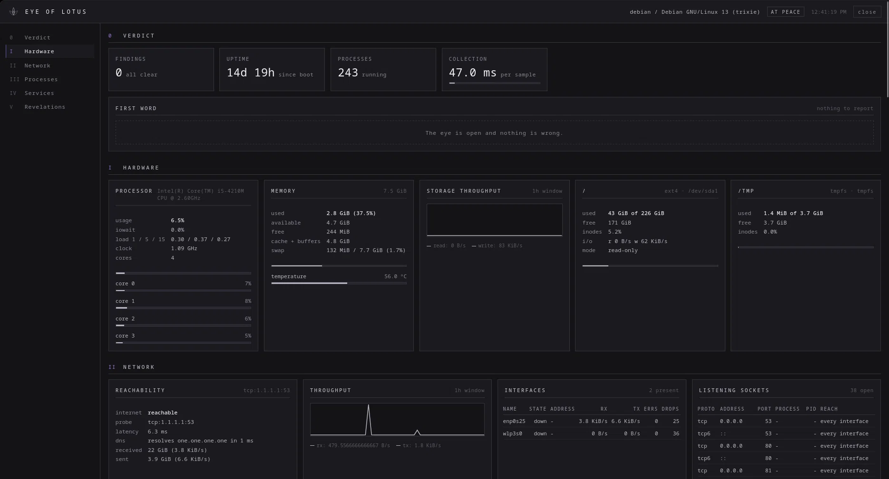

<div align="center">


# EYE OF LOTUS

**Наблюдающий, но не вмешивающийся глаз на Linux-сервере.**

Железо, сеть, процессы, юниты systemd, контейнеры и вердикт о том, что
сломано - в одном небольшом бинарнике без зависимостей, который ничего не
может испортить.

[English version](README.md) · [Настройка](docs/configuration.md) · [API](docs/api.md)

</div>

---

## Что это

Один бинарник на Go, который следит за одной Linux-машиной и отдаёт про
неё веб-страницу. Он читает `/proc`, `/sys`, шину systemd и сокет Docker.
Он не пишет ничего, кроме собственной базы истории, и в его HTTP API нет
ни одного метода, способного изменить состояние машины.




## Что показывает

| Раздел | Содержимое |
|---|---|
| **0 Вердикт** | Худшая находка прямо сейчас, их количество, uptime, время сбора |
| **I Железо** | CPU суммарно и по ядрам, load average, iowait, steal, температура, RAM и swap, все реальные файловые системы с заполнением, inode и дисковым потоком |
| **II Сеть** | Доступность интернета через TCP-пробу, разрешение DNS и его задержка, пропускная способность, все интерфейсы с ошибками и дропами, все слушающие сокеты с процессом-владельцем и признаком «смотрит в сеть» |
| **III Процессы** | Таблица процессов по CPU: пользователь, RSS, потоки, состояние, возраст |
| **IV Сервисы** | Юниты systemd (работает, упал, автозапуск, рестарты) и контейнеры Docker (состояние, health, цикл перезапуска) |
| **V Откровения** | Каждая находка с объяснением и подсказкой, плюс сохранённая история |

Движок проблем следит за: заполнением файловых систем и исчерпанием
inode, нехваткой памяти, активным swap, load выше числа ядер, ожиданием
диска, украденным гипервизором CPU, пропавшим интернетом, сломанным и
медленным DNS, чувствительными портами, открытыми в сеть, упавшими
юнитами, нездоровыми и зацикленно перезапускающимися контейнерами,
высокой температурой, файловыми системами только для чтения и
зомби-процессами.

Все пороги публикуются через API, поэтому интерфейс объясняет вердикт, а
не просто утверждает его.

## Чем он не является

- **Не агент.** Он следит за машиной, на которой запущен. Нет центрального
  сервера, нет парка машин и нет входящих подключений.
- **Не панель управления.** Ни рестарта, ни kill, ни правки. В HTTP API
  нет ни одного метода, который что-либо меняет.
- **Не замена Prometheus.** Нет endpoint'а для скрейпа и нет правил
  алертинга. Он отвечает на один вопрос: всё ли в порядке с этой машиной.

## Оформление

Интерфейс - графит, плоские рамки в один пиксель, одно моноширинное
семейство и ничего декоративного, что не несёт смысла:

- без градиентов, свечения и неона - каждый цвет это одно плоское значение
- статус - маленький квадрат: белый значит норма, фиолетовый -
  предупреждение, жёсткое мигание багровым - критично
- движение ограничено линейным изменением ширины шкал и миганием;
  `prefers-reduced-motion` выключает мигание
- знак «глаз и лотос» нарисован тонкими линиями SVG, разделитель из пяти
  лепестков, римские цифры у разделов

## Быстрый старт

### Посмотреть без сервера

```bash
go build -o eye-of-lotus ./cmd/eye-of-lotus
./eye-of-lotus -demo
# открыть http://127.0.0.1:9110
```

Демо-режим показывает синтетическую машину. Пароль не нужен, на вашей
машине ничего не читается. Через две минуты у демо-машины начинает
заполняться файловая система: через несколько минут появляется
предупреждение, а затем критичное - чтобы были видны оба уровня статуса.

### Установка на сервер

Есть установщик, который делает все пять шагов ниже одной командой:

```bash
CGO_ENABLED=0 go build -trimpath -ldflags "-s -w" -o eye-of-lotus ./cmd/eye-of-lotus
sudo deploy/install.sh -b ./eye-of-lotus
```

Он создаёт служебного пользователя, спрашивает пароль и сохраняет его хеш,
пишет конфигурацию, ставит юнит и запускает сервис. Повторный запуск - это
обновление: бинарник и юнит заменяются, существующая конфигурация остаётся
нетронутой.

То же самое руками:

```bash
# 1. Сборка (Go 1.26 или новее, больше ничего не требуется)
CGO_ENABLED=0 go build -trimpath -ldflags "-s -w" -o eye-of-lotus ./cmd/eye-of-lotus

# 2. Служебный пользователь и каталоги
sudo useradd --system --home /var/lib/eye-of-lotus --shell /usr/sbin/nologin eye-of-lotus
sudo install -d -o eye-of-lotus -g eye-of-lotus /var/lib/eye-of-lotus /etc/eye-of-lotus

# 3. Выбрать пароль (на экран выводится хеш, не пароль)
./eye-of-lotus -hash-password 'длинная парольная фраза'

# 4. Записать конфигурацию
sudo install -o eye-of-lotus -g eye-of-lotus -m 0600 \
  deploy/config.example.json /etc/eye-of-lotus/config.json
sudoedit /etc/eye-of-lotus/config.json    # вставить хеш, поправить остальное

# 5. Установить и запустить
sudo install -m 0755 eye-of-lotus /usr/local/bin/eye-of-lotus
sudo install -m 0644 deploy/eye-of-lotus.service /etc/systemd/system/
sudo systemctl daemon-reload
sudo systemctl enable --now eye-of-lotus
```

По умолчанию панель слушает `127.0.0.1:9110`. Добираться до неё лучше
через SSH-туннель (`ssh -L 9110:127.0.0.1:9110 server`) или обратный
прокси - оба варианта безопаснее публикации порта, даже с паролем.

Чтобы панель была доступна из локальной сети, ставь с флагом
`-l 0.0.0.0:9110` либо запусти установщик с ним повторно, чтобы перевести
уже установленную панель. Вход throttled, API только на чтение, но по
обычному HTTP cookie сессии идёт открытым текстом, поэтому держи её в
сети, которой доверяешь, либо поставь впереди сертификат.

Чтобы видеть контейнеры хоста, пользователь панели должен входить в
группу `docker` - сокет демона принадлежит `root:docker`. Установщик
добавляет его сам, а `--no-docker-group` это пропускает, но тогда раздел
контейнеров скажет, что демон недоступен.

### Что делает установщик

Он запускается от root, и стоит знать, на что именно уходят эти права:

| Шаг | Зачем нужен root |
|---|---|
| Создаёт системного пользователя и группу `eye-of-lotus` | панель не должна работать от root, ей нужен свой аккаунт |
| Добавляет пользователя в группу `docker` | сокет демона принадлежит `root:docker`; без этого раздел контейнеров скажет, что демон недоступен |
| Кладёт бинарник в `/usr/local/bin` и юнит в `/etc/systemd/system` | оба каталога принадлежат root |
| Пишет `/etc/eye-of-lotus/config.json` с правами 0600 | там единственный пароль, и тот в виде хеша |
| Создаёт `/var/lib/eye-of-lotus` | единственный путь, куда сервису разрешено писать |
| Открывает фаервол, если он активен | одно правило для локального интерфейса и одно для докерных сетей, и ничего сверх этого |
| Включает и запускает сервис | systemd |

Больше он не трогает ничего. Флаги `--no-docker-group` и `--no-firewall`
пропускают эти два шага, а `--uninstall` отменяет всё сделанное.

Про правило для докерных сетей стоит сказать отдельно, потому что оно
удивляет. Обратный прокси, запущенный в Docker, приходит к панели со
своего мостового адреса, а не из локальной сети. Фаервол, который молча
дропает такой пакет, оставляет прокси ждать ответа, и браузер крутится на
странице, которой до работы не хватает одного пропущенного пакета.

### Docker

```bash
cp .env.example .env      # указать EOL_PASSWORD
docker compose up -d
```

Контейнер видит железо, сеть и процессы по-настоящему (общее ядро и, при
`pid: host`, общее пространство процессов). Состояние systemd внутри
контейнера недоступно, если специально не пробросить сокет D-Bus хоста -
см. комментарии в `docker-compose.yml`. Для полной картины ставьте панель
нативно.

## Настройка

Всё живёт в одном JSON-файле, по умолчанию
`/etc/eye-of-lotus/config.json`. Любой ключ можно переопределить
переменной окружения (`EOL_LISTEN`, `EOL_PASSWORD`, `EOL_DATABASE`, ...) и
флагом командной строки - в порядке возрастания приоритета.

```bash
./eye-of-lotus -print-config       # показать итоговую конфигурацию
./eye-of-lotus -hash-password 'x' # получить хеш пароля
./eye-of-lotus -no-history         # работать без базы данных
./eye-of-lotus -proc-root /mnt/image   # посмотреть на смонтированный образ
```

Полный справочник - в [docs/configuration.md](docs/configuration.md).

Пароли хранятся как PBKDF2-HMAC-SHA256 с 210 000 итераций. Пароль в
открытом виде тоже работает, но панель ругается на него в логе при каждом
запуске.

## API

Всё, что делает интерфейс - это документированные HTTP-запросы только на
чтение, поэтому данные легко автоматизировать:

```bash
curl -c jar -X POST -H 'Content-Type: application/json' \
     -d '{"password":"secret"}' http://127.0.0.1:9110/api/auth/login
curl -b jar http://127.0.0.1:9110/api/snapshot | jq '.verdict'
```

Полный список - в [docs/api.md](docs/api.md).

## Как это устроено

```
cmd/eye-of-lotus      точка входа, цикл сбора, корректное завершение
internal/proc         парсеры /proc и /sys, тестируемые на фикстурах
internal/collect      сборщики, расчёт скоростей, движок проблем, демо-машина
internal/systemd      systemd через D-Bus, реализовано внутри проекта
internal/dbus         минимальный клиент D-Bus, делающий это возможным
internal/docker       Docker API через unix-сокет, только GET
internal/store        история в SQLite: raw, minute и hour
internal/web          HTTP, аутентификация, встроенный одностраничный интерфейс
web assets            HTML, CSS и JavaScript, вшитые в бинарник
```

**Почти нет зависимостей.** SQLite - единственная, и она на чистом Go,
поэтому `CGO_ENABLED=0` даёт статический бинарник. systemd доступен через
клиент D-Bus, написанный для этого проекта, а не через библиотеку; Docker
- через небольшой HTTP-клиент поверх сокета.

**Нет сборки фронтенда.** Интерфейс - обычные HTML, CSS и JavaScript,
вшитые через `embed`. Нет Node, нет бандлера, нет `node_modules`. Правишь
стили и пересобираешь бинарник - это весь цикл разработки.

## Разработка

```bash
go test ./...            # юнит-тесты, включая тесты сборщиков на фикстурах
go vet ./...
gofmt -l .
go run ./cmd/eye-of-lotus -demo -log-level debug
```

Тесты сборщиков создают поддельное дерево `/proc` и `/sys` и проверяют,
что парсеры и движок проблем ведут себя правильно: что 93% занятой памяти
становятся критичной находкой, что открытый порт 2375 помечается, что
командная строка процесса со скобками всё ещё разбирается.

Две вещи стоит знать, если раздел Services выглядит не так, как ожидалось.
Панель общается с шиной systemd напрямую, а не через `systemctl`, и каждый
клиент обязан представиться шине первым сообщением; для проверки этого
пути есть `cmd/probe`, который показывает, что шина отвечает на каждом
шаге:

```bash
go run ./cmd/probe
```

И ещё: часть дистрибутивов запрещает непривилегированному пользователю
запрос версии systemd, разрешая при этом список юнитов. Поэтому пустая
версия при полном списке юнитов - это норма, а не поломка. Когда systemd
или Docker действительно недоступны, раздел объясняет причину вместо
пустого списка.

## Авторы

Даниил ([@nelvixboy](https://github.com/nelvixboy)) - идея, требования,
тестирование и приёмка.

DeepSeek Harness - ИИ-агент, который по его постановке написал код на Go,
интерфейс и документацию.

## Лицензия

MIT. См. [LICENSE](LICENSE).
